# PulseTech Storefront

> A full-featured technology e-commerce storefront built with **Next.js 16**, **React 19**, **TypeScript**, and a Java/Spring Boot microservice backend.

[](https://pulse-tech-beryl.vercel.app)
[](https://github.com/VuIceTea/PulseTech-Admin)
[](https://github.com/VuIceTea/PulseTech-Backend)

## Overview

PulseTech is a responsive customer-facing shopping application for phones, tablets, laptops, wearables, audio devices, and accessories. It connects to the PulseTech API Gateway through the `/backend-api/*` proxy, so browser clients never need direct microservice addresses.

### Shopping experience

- Dynamic home page with CMS-managed navigation, banners, categories, promotions, flash sales, and featured products.
- Product catalog with keyword search, category/brand/specification filters, price ranges, sorting, and responsive product cards.
- Product detail pages with color and storage variants, variant-level prices and stock, category-specific specifications, image galleries, reviews, quantity validation, wishlist, and related promotions.
- Side-by-side product comparison for price and technical specifications.
- Persistent guest/member cart backed by the Order Service, with cart merging after login.
- Wishlist synchronized to the signed-in customer account.

### Checkout, promotions, and orders

- Checkout through **COD, VNPay QR, MoMo, and Stripe**.
- Product and shipping vouchers can be combined, while only one voucher of each type is active at a time.
- Per-customer voucher quantities, one-time consumption, replacement rules, validation, and cart-to-checkout transfer.
- Order confirmation dialog, payment return handling, automatic cart cleanup, and variant stock deduction.
- Order history, order cancellation rules, public order tracking, and return/refund requests.
- Customer profile with personal information, saved delivery addresses, reward points, membership tier, and assigned vouchers.

### Customer support

- AI shopping assistant grounded in live product, variant-stock, and policy data.
- Warranty and IMEI lookup by IMEI, phone number, or order number.
- Store locator, trade-in pricing experience, technology blog, and policy center.
- Registration with email verification and custom client-side validation messages.
- Reusable skeleton loading states and responsive layouts across the storefront.

## Interface Preview

All screenshots below were captured from the local application at `http://localhost:3000` using live backend data.

### Discover and compare products

| Home page | Product catalog |
|---|---|
| 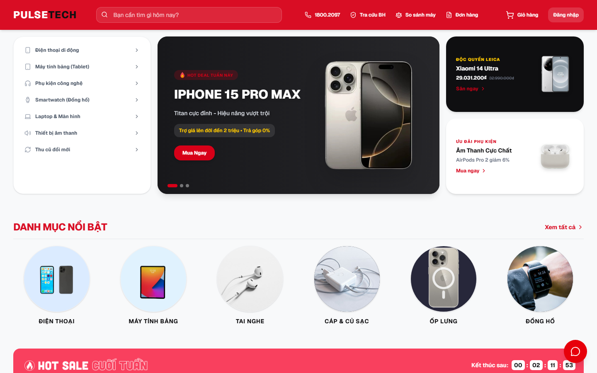 | 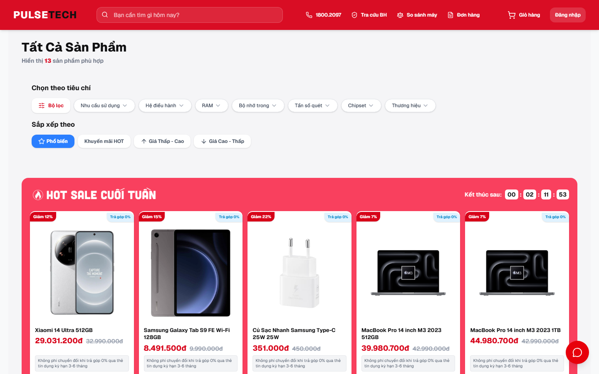 |

| Product detail and variants | Product comparison |
|---|---|
| 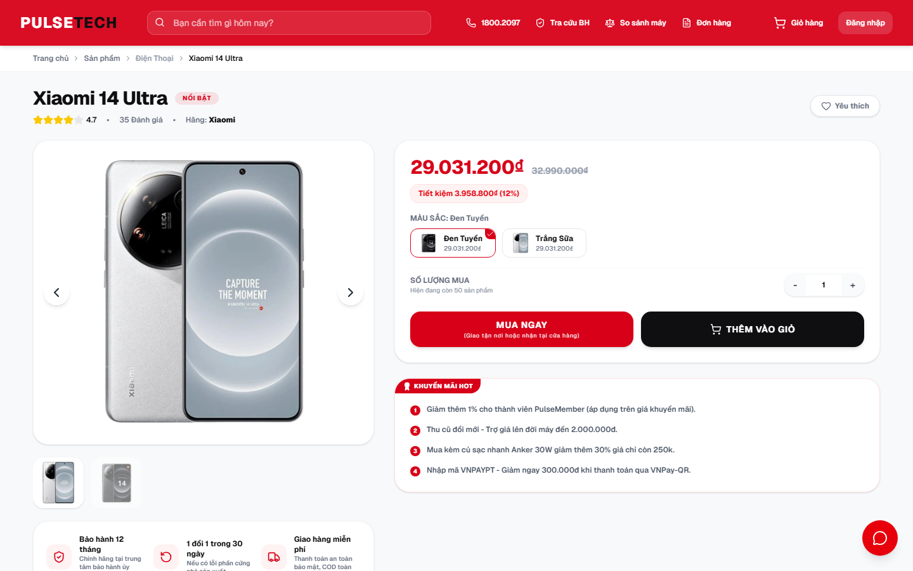 | 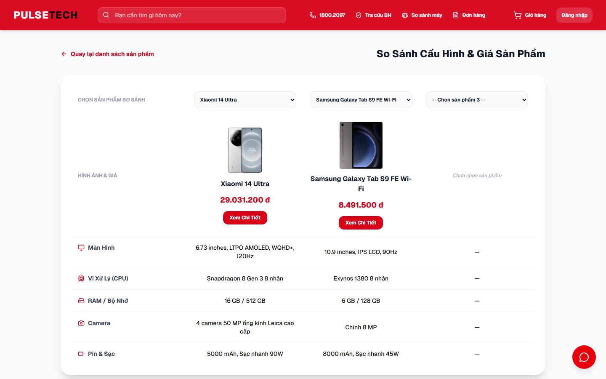 |

### Cart and checkout

| Shopping cart and vouchers | Multi-method checkout |
|---|---|
| 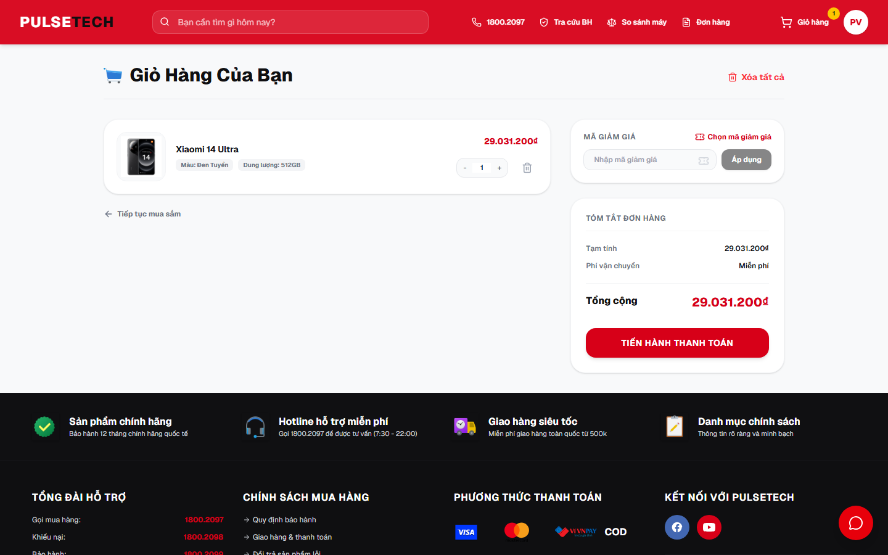 | 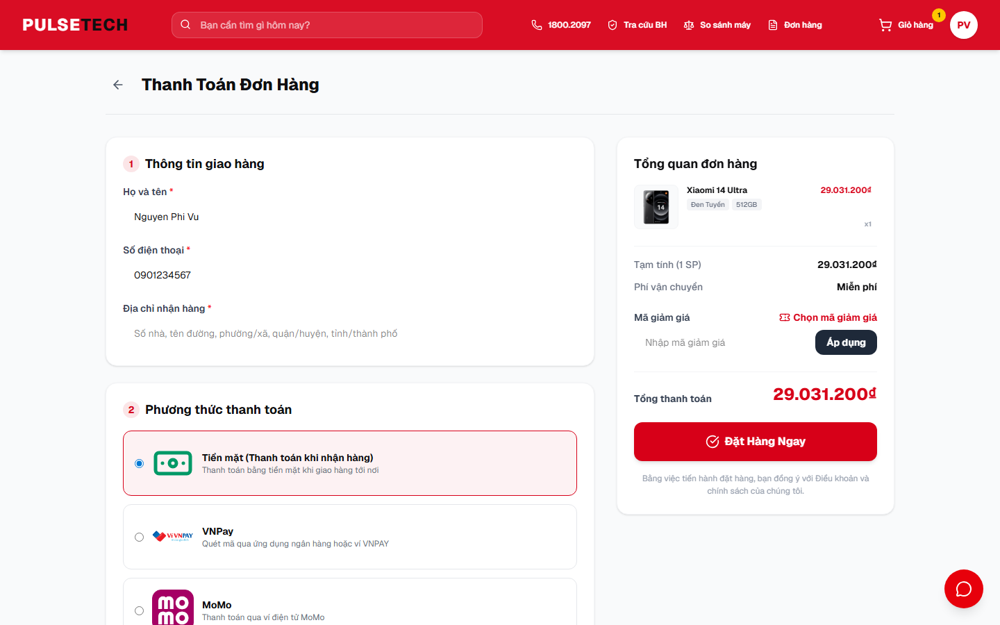 |

### Order and after-sales support

| Public order tracking | Warranty and IMEI lookup |
|---|---|
| 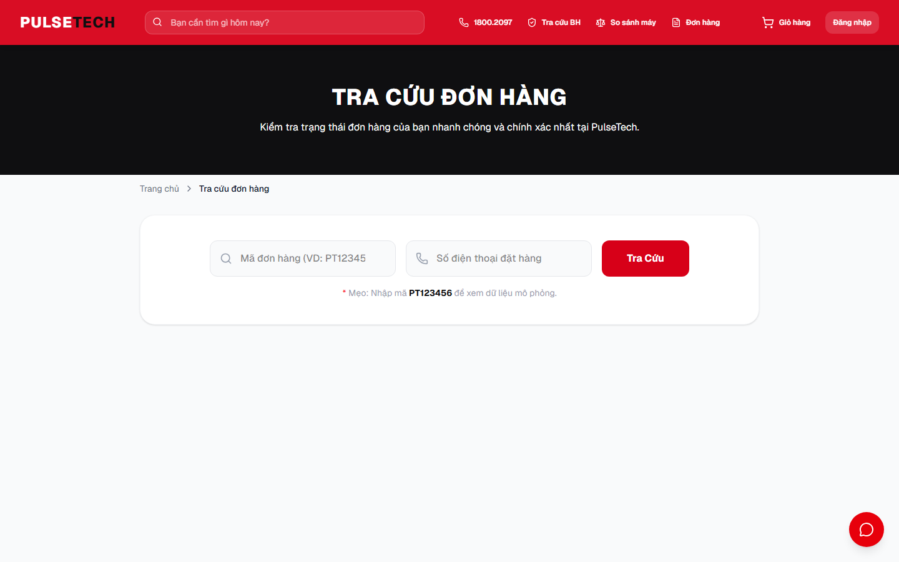 | 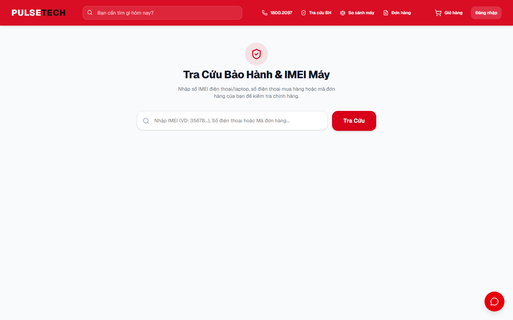 |

| Store system | Trade-in program |
|---|---|
| 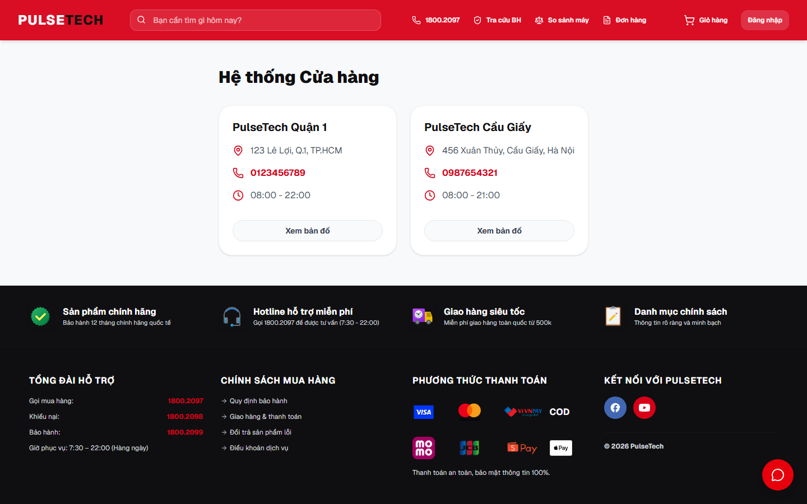 | 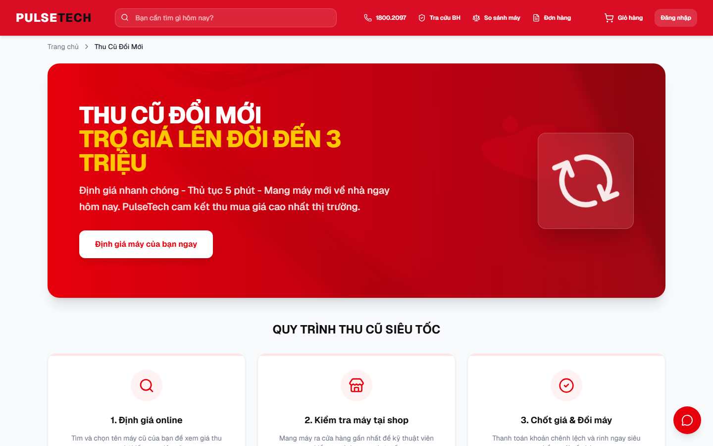 |

### Content and account access

| Technology blog | Policy center |
|---|---|
| 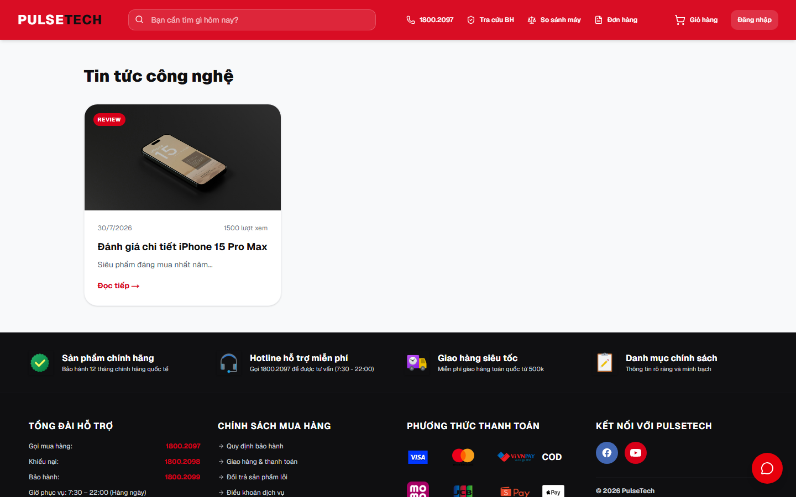 | 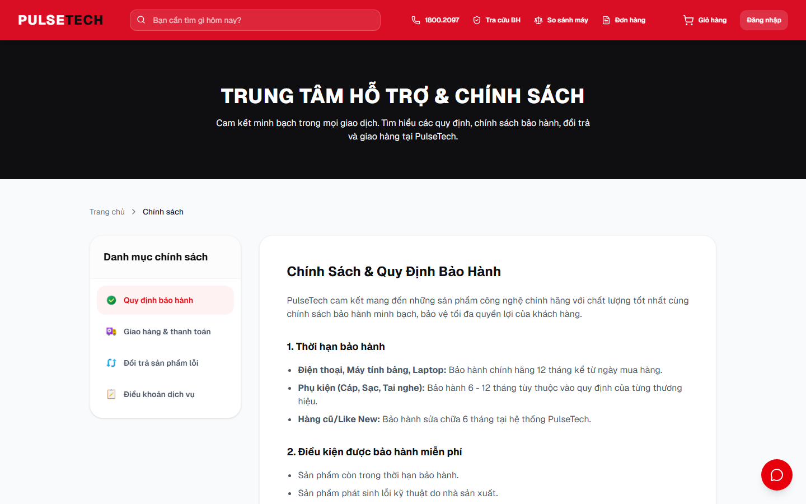 |

| Customer login | Customer registration |
|---|---|
| 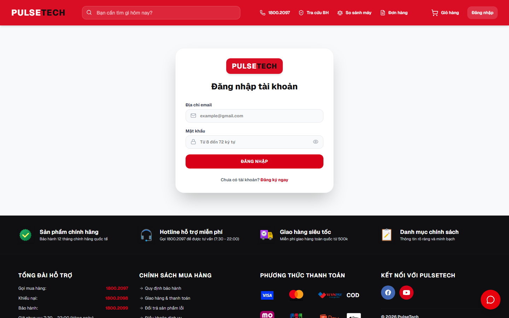 | 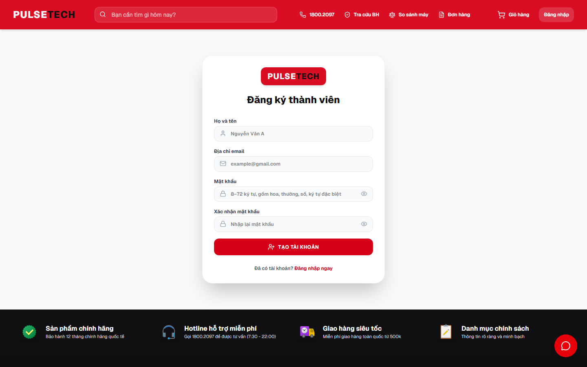 |

The operational dashboard is documented separately in the [PulseTech Admin repository](https://github.com/VuIceTea/PulseTech-Admin#interface-preview).

## Tech Stack

| Area | Technology |
|---|---|
| Framework | Next.js 16 App Router |
| UI | React 19, TypeScript 5, Tailwind CSS 4 |
| Components | shadcn/ui, Radix UI, Lucide React, React Icons |
| Motion and feedback | Framer Motion, Sonner |
| AI assistant | AI SDK with Google/Groq providers |
| Payments | COD, VNPay, MoMo, Stripe |
| Backend integration | REST APIs through Spring Cloud Gateway |
| Deployment | Vercel, Docker standalone output |

## Application Routes

| Route | Purpose | Login required |
|---|---|:---:|
| `/` | Home, promotions, categories, and featured products | No |
| `/products` | Searchable and filterable product catalog | No |
| `/products/[id]` | Product detail, variants, stock, reviews, and purchase actions | No |
| `/compare` | Product specification comparison | No |
| `/cart` | Cart management and voucher selection | No |
| `/checkout` | Delivery details, vouchers, and payment selection | Yes |
| `/order-tracking` | Public lookup by order ID and phone | No |
| `/orders` | Customer order history and return/cancel actions | Yes |
| `/wishlist` | Saved products | Yes |
| `/profile` | Account, addresses, rewards, and vouchers | Yes |
| `/warranty` | Warranty and IMEI lookup | No |
| `/stores` | PulseTech store locations | No |
| `/trade-in` | Trade-in flow and estimated prices | No |
| `/blog` | Technology articles | No |
| `/policies` | Warranty, shipping, return, and service policies | No |
| `/login` | Customer authentication | No |
| `/register` | Account registration | No |
| `/verify-email` | Email verification callback | No |

## Project Structure

```text
frontend/
├── src/
│   ├── app/                 # Next.js pages, loading UI, and AI chat route
│   ├── components/          # Header, footer, product cards, chat, and shared UI
│   ├── context/             # Authentication, cart, and wishlist state
│   ├── lib/                 # REST client, validation, coupon, and utility logic
│   ├── config/              # Catalog and application configuration
│   └── types/               # Product and shared TypeScript models
├── docs/screenshots/        # README interface gallery
├── public/                  # Static images and icons
├── next.config.ts           # Standalone output and API Gateway rewrite
├── Dockerfile
└── package.json
```

## Local Development

### Prerequisites

- Node.js 20 or newer
- npm 10 or newer
- PulseTech API Gateway running at `http://localhost:8080`

### Run the storefront

```bash
git clone https://github.com/VuIceTea/PulseTech.git
cd PulseTech
npm install
cp .env.example .env.local
npm run dev
```

Open [http://localhost:3000](http://localhost:3000).

### Environment

```env
API_URL=http://localhost:8080
```

The Next.js rewrite maps:

```text
/backend-api/<path> -> ${API_URL}/api/<path>
```

### Scripts

| Command | Description |
|---|---|
| `npm run dev` | Start the local development server |
| `npm run build` | Create the optimized production build |
| `npm run start` | Run the production build |
| `npm run lint` | Run ESLint |

## Deployment

The repository is configured for Vercel. Set `API_URL` to the public API Gateway address, then deploy the `main` branch. The application uses Next.js standalone output and can also be packaged with Docker.

## Related Repositories

- [PulseTech Admin](https://github.com/VuIceTea/PulseTech-Admin) — management dashboard.
- [PulseTech Backend](https://github.com/VuIceTea/PulseTech-Backend) — Java/Spring Boot microservices, MongoDB, Redis, payments, and API Gateway.

## Development Notes

- `main` is the deployment branch; `VuDev` is used for active development.
- Do not commit `.env` or provider credentials.
- Prices, stock, vouchers, and order states are validated by backend services rather than trusted from the browser.
